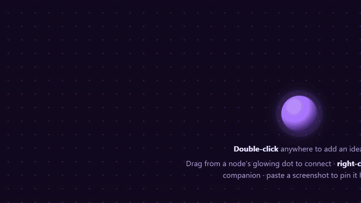

<p align="center"></p>

<p align="center">
  <a href="https://github.com/offensiveadhd/lets-unique-graph/actions/workflows/validate.yml"></a>
  
  
  
  <a href="LICENSE"></a>
</p>

<p align="center"><b>Talk to Claude in diagrams.</b><br>The first <a href="https://github.com/offensiveadhd/lets">lets</a> unique: a dark-violet node/edge board where you draw the thing you mean while you chat, and the companion (Doto) reads, points, suggests and edits the same board.</p>

<p align="center">
  <a href="#see-it-run">See it run</a> ·
  <a href="#install">Install</a> ·
  <a href="#what-you-can-do">What you can do</a> ·
  <a href="#ask-doto">Ask Doto</a> ·
  <a href="#the-native-view">Native view</a> ·
  <a href="#how-claude-drives-it">How Claude drives it</a> ·
  <a href="#layout">Layout</a> ·
  <a href="#develop">Develop</a>
</p>

## See it run

<p align="center">
  <a href="assets/demo.mp4"></a>
</p>

One real take of the graph window on a real lets host, recorded in a headless browser. The hand draws,
connects, types in the chat and clicks through the browser's own input. Claude's side (the nodes it adds,
the layout, the answers, Doto's lines) is sent through the engine's own tools by a script written ahead,
following [GUIDE.md](GUIDE.md), because a recording cannot wait on a live model. Select the picture for the
[full take](assets/demo.mp4). How it was recorded is in
[lets/promo](https://github.com/offensiveadhd/lets/tree/main/promo).

## Install

It comes with `lets`: the engine installs `graph` into `~/.lets/uniques/graph` the first time it runs (it is listed in the engine's `defaults.json`). Then:

```
/lets:lets graph          # or /lets graph with the alias
```

Manual: `/lets store graph` (inspect → confirm), or clone this repo into `~/.lets/uniques/graph`, or set `LETS_UNIQUES_DIRS=<parent folder>` while developing.

## What you can do

<p align="center">
  
</p>

- Double-click to add a node; drag from a node's glowing dot (or select one and Shift+click another) to connect; double-click a label to rename; marquee-select; Ctrl+Z/Y; Delete.
- Node kinds: idea, step, decision, data, note, image, group. Keys 1–5 change the kind of the selection.
- Toolbar: add per kind, connect mode, tree / grid / radial auto-layout, fit, new, **Send to Claude**, **Ask**, chat, companion, `?` shortcuts.
- **Send to Claude** hands the board over: the engine saves it as a session, the window says goodbye and closes, and Claude answers in the Claude Code chat. Say *continue* (or `/lets graph resume`) and the board comes back as you left it, with Claude's suggestions drawn in.
- Paste or drop a screenshot: it becomes an image node and Claude gets the file path.
- Everything persists locally per window and survives reloads.

### Ask Doto

<p align="center">
  
</p>

Right-click summons or dismisses Doto; click Doto for questions about what you selected ("Explain this", "What's missing around …?", "Suggest what comes next", "Break it into steps", "Critique it", "Better name?") or about the whole board ("What do you see?", "Suggest a structure", "Review the flow"). Claude answers in the chat panel and points at the nodes it means.

### The native view

`/lets graph native` opens the board as a pane inside Claude Code (lets 0.7.0 and the lets-native mod) instead of a browser window. The pane shows the board as a picture, your nodes as a list of buttons, an editor for what you select (rename, kind, details, connect, note, remove), an *add* box and an *ask* box. Claude and Doto work the same way in both, and *Send to Claude* / resume carry the board across.

## How Claude drives it

<p align="center"></p>

Events (up): `graph.changed`, `graph.node.select`, `graph.node.create|update|delete`, `graph.edge.create|delete`, `graph.export`, `graph.ask`, `graph.snapshot`.
Commands (down): `graph.load`, `graph.clear`, `graph.node.add|set|remove`, `graph.edge.add|remove`, `graph.layout`, `graph.focus`, `graph.highlight`, `graph.annotate`, `graph.snapshot`.

The manifest's `session` block (`export: graph.export`, `snapshot: graph.snapshot`, `restore: graph.load`) is what lets the engine save and resume boards.

[GUIDE.md](GUIDE.md) is what Claude reads when it opens the board. [CONTRACT.md](CONTRACT.md) is the build contract (board behaviour, event and command shapes). `schemas/` holds JSON Schemas for the graph document and the main messages.

<details>
<summary>The take above, as the messages that crossed</summary>

| Who | Message | What you see |
|---|---|---|
| you | `graph.node.create` twice, `graph.edge.create` | two nodes drawn by hand, API gateway and Auth service, and the edge between them |
| you | `chat.message` | "Add the rest of the login flow and tidy it up" |
| Claude | `graph.node.add` three times, `graph.edge.add` three times | a decision, Token valid?, with a yes branch to Users DB and a no branch to Reject 401 |
| Claude | `graph.layout`, `graph.focus` | the board laid out as a tree and fitted |
| you | `graph.ask` | Auth service selected, then "What's missing around …?" from Doto's menu |
| Claude | `graph.highlight`, `graph.node.add`, `graph.edge.add`, `graph.annotate` | the answer in chat, the node it means lit, Retry + backoff added, a note pinned |
| you | `graph.export` | **Send to Claude**: the engine saves the session and the window says goodbye |

</details>

## Layout

```
unique.json    LIP manifest (name, entry, native, domains, events, commands, permissions)
GUIDE.md       instructions for Claude
CONTRACT.md    behaviour spec
icon.svg
schemas/       JSON Schemas
ui/            index.html, graph.js (board), layout.js (auto-layouts), style.css
native/        index.js — the native view: the same board as a pane in Claude Code
scripts/       validate.mjs — manifest + schema check, native/index.js parse (zero dependencies)
               native-smoke.mjs — drives the native view headlessly through an engine checkout
assets/        what this README shows: the banner, the recordings, the diagram
```

The UI imports the engine's SDK at runtime (`/sdk/lets-client.js`, `/sdk/lets-shell.js`); it has no build step and no dependencies. The native view is one plain script the lets host runs in a `node:vm` context (no imports, no timers); CONTRACT.md §5 describes its pane and keys.

## Develop

```bash
# in a lets checkout, with this repo next to it
LETS_UNIQUES_DIRS=../ node engine/bin/lets.mjs serve --open graph --verbose   # serves ../graph? no: point it at the PARENT of a folder named like the unique
```

Simplest: symlink or copy this folder to `~/.lets/uniques/graph` (that is where the default install lives) and run the engine's `serve`. Validate with `node scripts/validate.mjs` here, or `node engine/bin/lets.mjs validate <this folder>` from the engine.

Native view: `node scripts/native-smoke.mjs` runs it headlessly against the engine checkout next to this repo (or `LETS_ENGINE=<path>`; `--print` shows the pane as text). On a running host, `node engine/bin/lets.mjs native graph` opens one and prints its pane; `--w <id> --act '{"key":"u.add","kind":"submit","value":"Start"}'` acts on it.

## License

MIT © offensiveadhd
